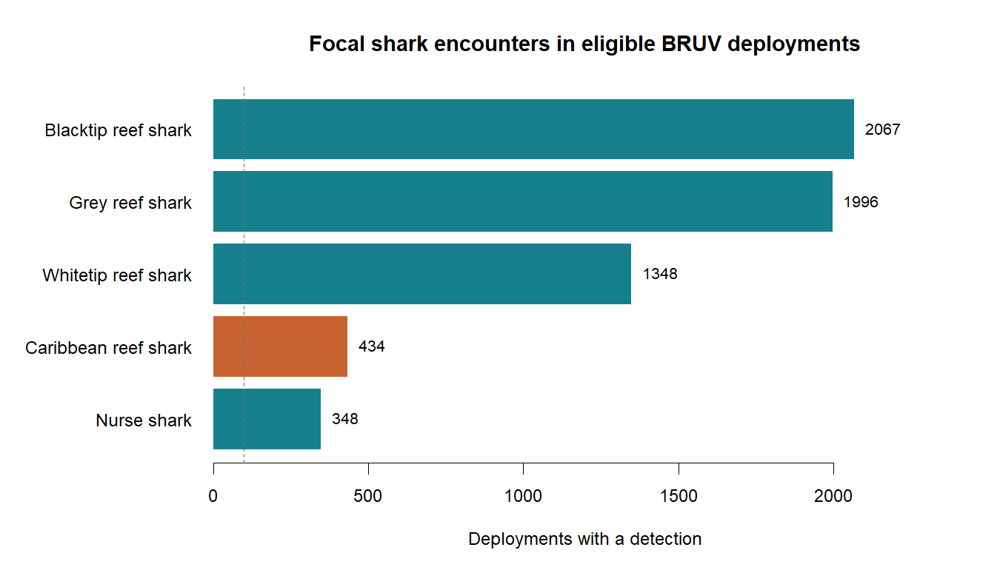
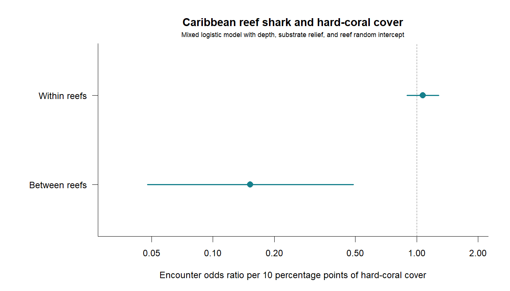
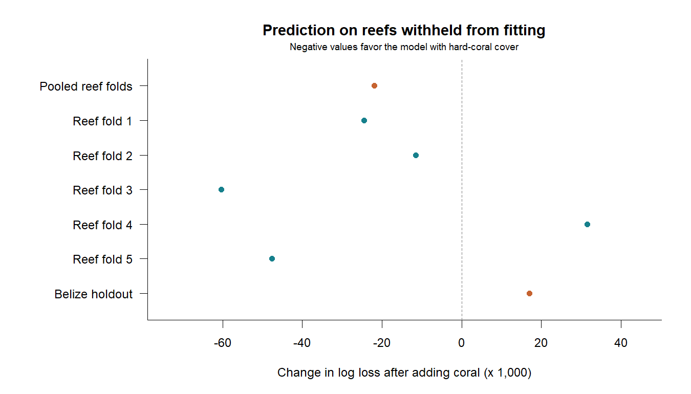

# Hard-coral cover and reef shark encounters
## A Global FinPrint analysis with whole-reef validation

Does hard-coral cover scored from baited remote underwater video (BRUV) help predict a Caribbean reef shark encounter on a reef the model has never seen? This project uses deployment data from Simpfendorfer et al. (2023) to answer a new question using their archived data.

### Findings

The focal model uses **2,473 Western Atlantic deployments across 69 reefs**, with **434 Caribbean reef shark encounters**. All five focal species passed the screen.

| Focal shark | Positive deployments | Reefs with both outcomes |
| --- | ---: | ---: |
| Blacktip reef shark | 2,067 | 144 |
| Grey reef shark | 1,996 | 167 |
| Whitetip reef shark | 1,348 | 173 |
| Caribbean reef shark | 434 | 43 |
| Nurse shark | 348 | 51 |



Within a reef, adding 10 percentage points of hard-coral cover corresponded to an encounter odds ratio of **1.07** (95% Wald CI **0.89–1.28**). The between-reef odds ratio for a 10-point increase in reef mean coral cover was **0.15** (95% CI **0.05–0.49**). This negative cross-reef association may reflect geography, management, or other unmeasured differences. It does not establish a causal coral effect.



| Validation set | Reefs | Log loss without coral | Log loss with coral |
| --- | ---: | ---: | ---: |
| Pooled five-fold whole-reef predictions | 69 | 0.481 | 0.459 |
| Belize-only geographic holdout | 6 | 0.368 | 0.385 |

Lower log loss is better. Coral improved four of the five reef folds but worsened prediction for the six Belize reefs when the model was trained outside Belize. The Belize test covers 283 deployments and 32 encounters. The pooled results weight deployments equally. The Belize test is a separate split using a subset of the same archive.



### Data and model

1. Collapse the 21,217 archive rows to 16,860 deployments by set ID. Record an encounter when a focal species has positive MaxN in any row for the deployment. A zero means the species was unrecorded on that BRUV, and is not a verdict on true presence. Exclude one deployment with conflicting metadata across rows.
2. Keep deployments with recorded hard-coral cover (0–100%), depth (0–40 m), and substrate relief (0–5). This retains 13,220 deployments globally. True zero hard-coral scores are retained. Screen candidate sharks within broad ocean domains using at least 100 detections and 10 reefs with both encounter and non-encounter deployments. The Western Atlantic is used for Caribbean reef and nurse sharks. Other sampled ocean regions are used for grey, blacktip, and whitetip reef sharks. These are broad screening domains.
3. Focus on Caribbean reef sharks for the Belize research connection. Fit a binomial logistic model with a normally distributed reef random intercept, depth, substrate relief, and two coral terms. Within-reef coral is each deployment's cover minus the reef mean. Between-reef coral is the reef mean. Both are expressed in units of 10 percentage points. The model uses maximum likelihood with adaptive Gauss–Hermite quadrature. The full-data coefficients were checked with 20 and 40 nodes and agreed to within 0.00015 on the log-odds scale.
4. Randomly assign whole reefs to five folds with a fixed seed. Refit both models in each training split and integrate over the estimated reef random-intercept distribution for unseen reefs. Fit a second comparison with all Belize observations held out. The coral model uses the mean of the available measured coral scores for each test reef. That covariate uses habitat measurements only and assumes a batch of measurements is available before shark outcomes are predicted.
5. Compare with a model using the same reef random-intercept structure, depth, and relief. Save Brier score, log loss, and predictions for both models. Jointly adding within- and between-reef coral assesses their combined predictive contribution.

The data describe the visible benthos around each camera. In the focal sample, 2,177 deployments had zero recorded hard coral and only 46 reefs varied in hard-coral cover across deployments. The estimated linear effects rely on this coverage distribution. The complete-case subset may differ from unscored deployments. The model omits fishing pressure, protection, and other geographic factors. Reef-level validation does not guarantee transfer to a new country or monitoring program.

### Run in RStudio

Open [finprint-coral-sharks.Rproj](finprint-coral-sharks.Rproj). The project uses base R. Both the original CSV and the derived deployment table are included, so the analysis can run offline.

```r
source("run.R")         # Fit models, validate, save tables and PNGs
source("show-plots.R")  # Draw the three charts in the Plots pane
```

To rebuild the deployment table first, run `source("prepare-data.R")`. This expects the original Dryad CSV in `data/`. Its SHA-256 is `5cb3ba4f43cca0764bf4b70e46b9edae7381caaa08f3f0e0521de7631ce997f4`. The derived input excludes GPS coordinates.

| File | Contents |
| --- | --- |
| [results/data-audit.csv](results/data-audit.csv) | Deployment and completeness counts |
| [results/species-screen.csv](results/species-screen.csv) | Counts, regional denominators, and eligibility |
| [results/coefficients.csv](results/coefficients.csv) | Log odds, odds ratios, and Wald intervals |
| [results/validation-metrics.csv](results/validation-metrics.csv) | Pooled, fold-level, and Belize scores |
| [results/held-out-predictions.csv](results/held-out-predictions.csv) | Encounter outcomes and both predicted probabilities |
| [results/validation-by-reef.csv](results/validation-by-reef.csv) | Scores by held-out reef |

### Download the data

| File | What it contains |
| --- | --- |
| [Original deployment CSV](data/FinPrint_Set_Data_27Feb2022_WA_new_D_NA2.csv) | Unmodified CC0 file from the authors' Dryad archive |
| [Derived deployment table](data/deployments.csv) | One row per deployment, habitat covariates, and encounter indicators for five shark species |
| [Dryad dataset record](https://datadryad.org/dataset/doi:10.5061/dryad.qbzkh18h0) | Official archive with the full dataset, data dictionary, and sampling methods |

### Sources

- Simpfendorfer, C. A., Heithaus, M. R., Heupel, M. R., et al. (2023). Widespread diversity deficits of coral reef sharks and rays. *Science, 380*(6650), 1155–1160. [Article](https://doi.org/10.1126/science.ade4884)
- Simpfendorfer, C. A., Heithaus, M. R., Heupel, M. R., et al. (2023). *Widespread diversity deficits of coral reef sharks and rays* [Dataset]. Dryad. The source CSV is archived under CC0 1.0. [Data and sampling methods](https://doi.org/10.5061/dryad.qbzkh18h0)
- The authors' archived R code was consulted to verify source variables and focal species. The analysis here is implemented in the included project scripts. [Authors' code archive](https://doi.org/10.5281/zenodo.7030578)

